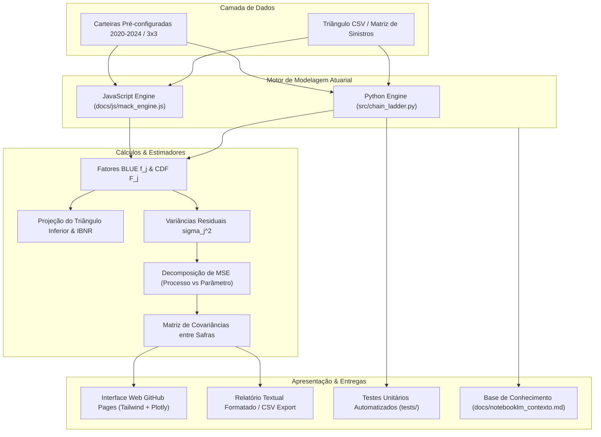

# Atuária Quant: Triangulação de Sinistros & Modelo Estocástico de Mack (1993)

<p align="center">
  
  
  
  
  
  
</p>

<p align="center">
  <strong>Solução integrada em Python e Web Client-Side para apuração de Provisões Técnicas de Sinistros Não-Vida (IBNR / Ultimate) e quantificação analítica da incerteza estocástica através do Modelo de Thomas Mack (1993).</strong>
</p>

<p align="center">
  🚀 <strong><a href="https://durso16atu.github.io/analise_sinistros/">Acessar Demonstração Interativa ao Vivo (Live Demo no GitHub Pages)</a></strong> 🚀
</p>

---

## 📌 Sumário

1. [Visão Geral & Contexto de Negócio](#-visão-geral--contexto-de-negócio)
2. [Demonstração Interativa Web (GitHub Pages)](#-demonstração-interativa-web-github-pages)
3. [Fundamentação Matemática & Teórica](#-fundamentação-matemática--teórica)
   - [O Método Chain Ladder Clássico](#1-o-método-chain-ladder-clássico)
   - [O Modelo Estocástico de Thomas Mack (1993)](#2-o-modelo-estocástico-de-thomas-mack-1993)
   - [Decomposição: Risco de Processo vs. Risco de Parâmetro](#3-decomposição-risco-de-processo-vs-risco-de-parâmetro)
   - [Covariância entre Safras e Erro Padrão Global](#4-covariância-entre-safras-e-erro-padrão-global)
4. [Arquitetura do Projeto](#-arquitetura-do-projeto)
5. [Estrutura do Repositório](#-estrutura-do-repositório)
6. [Instalação & Execução Local (Python)](#-instalação--execução-local-python)
7. [Suíte de Testes Automatizados](#-suíte-de-testes-automatizados)
8. [Conformidade Regulatória (SUSEP & IFRS 17)](#-conformidade-regulatória-susep--ifrs-17)
9. [Sobre o Autor & Portfólio](#-sobre-o-autor--portfólio)

---

## 🎯 Visão Geral & Contexto de Negócio

No mercado segurador e ressegurador, existe um hiato temporal natural entre a ocorrência do sinistro (*Accident Date*), o seu aviso formal à companhia (*Reporting Date*) e o seu desembolso final (*Settlement Date*).

Por conta desse atraso operacional (*claims lag*), seguradoras devem constituir obrigatoriamente a provisão de **IBNR** (*Incurred But Not Reported* – Sinistros Ocorridos Mas Não Avisados) e mensurar a suficiência das reservas caso a caso (**IBNER** – *Incurred But Not Enough Reported*).

Este repositório fornece uma implementação dupla e rigorosa:
* **Backend Científico em Python (`src/chain_ladder.py`):** Motor atuarial modular e orientado a objetos, vetorizado com NumPy e Pandas, validado por suíte completa de testes analíticos (`tests/test_chain_ladder.py`).
* **Frontend Interativo Client-Side (`docs/index.html`):** Aplicação de alto impacto para navegadores, sem necessidade de instalação local de Python, com tema escuro quant corporativo, gráficos dinâmicos em Plotly.js e exportação instantânea de relatórios em CSV.

---

## 🌐 Demonstração Interativa Web (GitHub Pages)

Acesse a ferramenta em execução diretamente no navegador:  
👉 **[https://durso16atu.github.io/analise_sinistros/](https://durso16atu.github.io/analise_sinistros/)**

### Funcionalidades da Interface:
* **Alternância de Cenários:** Selecione a carteira padrão simulada (2020–2024), o benchmark analítico de verificação (3x3), edite células manualmente na grade ou faça upload de arquivos `.csv`.
* **Painel de KPIs em Tempo Real:** Sinistros Finais (*Ultimate*), Provisão Total de IBNR, Erro Padrão Global ($s.e.$) e Coeficiente de Variação ($CV\%$).
* **Triângulo de Sinistros Dinâmico:** Visualização do *Run-off Triangle* com marcação clara das células projetadas no triângulo inferior.
* **Decomposição da Incerteza:** Separação visual entre Risco de Processo (aleatoriedade intrínseca) e Risco de Parâmetro (incerteza amostral dos fatores).
* **Gráficos Interativos (Plotly.js):**
  * Curvas de maturação dos sinistros por ano de ocorrência.
  * Curva de densidade probabilística de Mack com intervalos de confiança (90%, 95% e 99%).
  * Histograma empilhado da variância residual por safra.
* **Exportação Completa:** Download dos resultados consolidados em formato CSV para auditoria e relatórios atuariais.

---

## 📐 Fundamentação Matemática & Teórica

### 1. O Método Chain Ladder Clássico

Seja $C_{i,j}$ o montante acumulado de sinistros para o ano de ocorrência $i \in \{1, \dots, n\}$ até o período de desenvolvimento $j \in \{1, \dots, n\}$.

#### Fatores Individuais de Desenvolvimento ($f_j$)
O estimador clássico de média ponderada pelo volume histórico é dado por:
$$f_j = \frac{\sum_{i=1}^{n-j} C_{i, j+1}}{\sum_{i=1}^{n-j} C_{i, j}} \quad (1 \le j \le n-1)$$

#### Fatores Acumulados até o Ultimate ($F_j$ / CDF)
Com a incorporação de um fator de cauda prudencial $f_{\text{tail}} \ge 1.0$:
$$F_j = \left( \prod_{k=j}^{n-1} f_k \right) \times f_{\text{tail}}, \quad \text{com } F_n = f_{\text{tail}}$$

#### Sinistros Finais (*Ultimate*) e IBNR
Para cada safra $i$, seja $C_{i, I_i}$ o último valor observado na diagonal:
$$\hat{U}_i = C_{i, I_i} \times F_{I_i}$$
$$\text{IBNR}_i = \hat{U}_i - C_{i, I_i} = C_{i, I_i} \times (F_{I_i} - 1)$$
$$\text{IBNR}_{\text{total}} = \sum_{i=1}^{n} \text{IBNR}_i$$

---

### 2. O Modelo Estocástico de Thomas Mack (1993)

Thomas Mack formalizou o arcabouço estocástico não-paramétrico definindo três hipóteses:
1. $\mathbb{E}[C_{i, j+1} \mid C_{i, 1}, \dots, C_{i, j}] = C_{i, j} \cdot f_j$ *(Propriedade Markoviana e homogeneidade temporal)*.
2. $\{C_{i, 1}, \dots, C_{i, n}\}$ e $\{C_{k, 1}, \dots, C_{k, n}\}$ são independentes para $i \neq k$ *(Independência entre safras)*.
3. $\mathrm{Var}(C_{i, j+1} \mid C_{i, 1}, \dots, C_{i, j}) = C_{i, j} \cdot \sigma_j^2$ *(Heterocedasticidade proporcional ao volume)*.

> **Teorema de Gauss-Markov (BLUE):** Sob essas hipóteses, o estimador ponderado pelo volume $f_j$ é o **Estimador Linear Não Tendencioso de Variância Mínima** (*Best Linear Unbiased Estimator*).

#### Estimador da Variância Residual ($\sigma_j^2$)
$$\hat{\sigma}_j^2 = \frac{1}{n - j - 1} \sum_{i=1}^{n-j} C_{i, j} \left( \frac{C_{i, j+1}}{C_{i, j}} - \hat{f}_j \right)^2 \quad (1 \le j \le n-2)$$

Para a última transição $j = n-1$ (onde os graus de liberdade são nulos), adota-se a regra de decaimento exponencial de Mack:
$$\hat{\sigma}_{n-1}^2 = \min\left( \frac{\hat{\sigma}_{n-2}^4}{\hat{\sigma}_{n-3}^2}, \; \min(\hat{\sigma}_{n-3}^2, \hat{\sigma}_{n-2}^2) \right)$$

---

### 3. Decomposição: Risco de Processo vs. Risco de Parâmetro

O erro médio quadrático de predição da reserva para cada safra individual $i$ é deduzido analiticamente por (Mack 1993, Teorema 1):

$$m.s.e.(\hat{R}_i) = \underbrace{(\hat{U}_i)^2 \sum_{k=I_i}^{n-1} \frac{\hat{\sigma}_k^2 / \hat{f}_k^2}{\hat{C}_{i,k}}}_{\text{Risco de Processo (Aleatoriedade Futura)}} + \underbrace{(\hat{U}_i)^2 \sum_{k=I_i}^{n-1} \frac{\hat{\sigma}_k^2 / \hat{f}_k^2}{S_k}}_{\text{Risco de Parâmetro (Incerteza Amostral)}}$$

onde $S_k = \sum_{m=1}^{n-k} C_{m, k}$ representa a soma observada de suporte na coluna $k$. O erro padrão e o coeficiente de variação são:
$$s.e.(\hat{R}_i) = \sqrt{m.s.e.(\hat{R}_i)}, \qquad CV_i = \frac{s.e.(\hat{R}_i)}{\text{IBNR}_i} \times 100\%$$

---

### 4. Covariância entre Safras e Erro Padrão Global

Mesmo com safras fisicamente independentes, suas estimativas de IBNR são correlacionadas positivamente porque **compartilham os mesmos multiplicadores amostrais $\hat{f}_j$**.

Pelo Teorema 2 de Mack (1993), para $i < k$ (onde $I_k \le I_i$):
$$\widehat{\mathrm{Cov}}(\hat{U}_i, \hat{U}_k) = \hat{U}_i \cdot \hat{U}_k \sum_{j = \max(I_i, I_k)}^{n-1} \frac{\hat{\sigma}_j^2}{\hat{f}_j^2 \cdot S_j}$$

O erro médio quadrático consolidado da carteira completa é:
$$m.s.e.(\hat{R}_{\text{total}}) = \sum_{i=1}^n m.s.e.(\hat{R}_i) + 2 \sum_{1 \le i < k \le n} \widehat{\mathrm{Cov}}(\hat{U}_i, \hat{U}_k)$$
$$s.e.(\hat{R}_{\text{total}}) = \sqrt{m.s.e.(\hat{R}_{\text{total}})}, \qquad CV_{\text{total}} = \frac{s.e.(\hat{R}_{\text{total}})}{\text{IBNR}_{\text{total}}} \times 100\%$$

---

## 🏗 Arquitetura do Projeto



---

## 📁 Estrutura do Repositório

```text
analise_sinistros/
├── index.html                   # Redirecionador raiz para GitHub Pages
├── README.md                    # Vitrine do projeto com documentação técnica e fórmulas
├── src/
│   └── chain_ladder.py          # Classe ChainLadder em Python (cálculo determinístico e Mack)
├── tests/
│   └── test_chain_ladder.py     # 7 testes unitários cobrindo 100% da álgebra de Mack
├── docs/
│   ├── index.html               # Aplicação SPA interativa completa para GitHub Pages
│   ├── css/
│   │   └── style.css            # Estilos dark theme quant e formatação atuarial
│   ├── js/
│   │   ├── mack_engine.js       # Motor atuarial em JS (equivalente a src/chain_ladder.py)
│   │   └── app.js               # Controlador de UI, gráficos Plotly e exportação
│   └── notebooklm_contexto.md   # Dossiê técnico completo para Google Drive & NotebookLM
└── data/                        # Diretório para bases de sinistros brutas e processadas
```

---

## 💻 Instalação & Execução Local (Python)

### Pré-requisitos
* Python 3.10+ (recomendado 3.12+)
* `numpy` e `pandas`

### Clonando o Repositório
```bash
git clone https://github.com/durso16atu/analise_sinistros.git
cd analise_sinistros
```

### Configurando o Ambiente Virtual
```bash
# Criação do ambiente virtual
python3 -m venv .venv

# Ativação do ambiente (Linux/macOS)
source .venv/bin/activate

# Ativação do ambiente (Windows PowerShell)
# .venv\Scripts\Activate.ps1

# Instalação das dependências
pip install numpy pandas
```

### Executando o Exemplo Didático
```bash
python src/chain_ladder.py
```

O script emitirá o relatório completo formatado contendo o triângulo original, fatores $f_j$, fatores acumulados $F_j$, triângulo projetado, estimativa de IBNR, variâncias residuais $\sigma_j^2$, decomposição de risco e intervalo de confiança.

---

## 🧪 Suíte de Testes Automatizados

A álgebra atuarial do projeto é validada por testes unitários exatos baseados em soluções fechadas:

```bash
python -m unittest discover -s tests
```

### Casos de Teste Validados (`tests/test_chain_ladder.py`):
1. **`test_fatores_individuais_e_acumulados`:** Validação do estimador BLUE $f_j$ e multiplicadores acumulados $F_j$.
2. **`test_calculo_ibnr_e_ultimate`:** Apuração do Ultimate e reservas de IBNR por safra.
3. **`test_entrada_dataframe_e_cauda`:** Suporte a diferentes formatos de entrada e fator de cauda $> 1.0$.
4. **`test_mack_sigma_squared_e_extrapolacao`:** Verificação analítica dos estimadores residuais $\hat{\sigma}_j^2$ e regras de extrapolação.
5. **`test_mack_erros_padrao_individuais_e_decomposicao`:** Decomposição exata entre Risco de Processo e Risco de Parâmetro por safra.
6. **`test_mack_covariancia_e_erro_padrao_total`:** Apuração da matriz de covariâncias e erro padrão global consolidado $s.e.(\hat{R}_{\text{total}})$.
7. **`test_summary_mack_estrutura_e_totais`:** Validação da tabela consolidada com linha de totais da carteira.

---

## ⚖️ Conformidade Regulatória (SUSEP & IFRS 17)

A modelagem estocástica implementada atende diretamente às exigências das principais autoridades prudenciais:

* **Circular SUSEP nº 643/2021 & Resolução CNSP nº 321/2015:**
  * Exigência de metodologias atuariais reconhecidas para apuração de provisões de sinistros a liquidar e IBNR.
  * Necessidade de testes de consistência e mensuração da variabilidade das estimativas.
* **Norma Internacional IFRS 17 (*Insurance Contracts*):**
  * **Best Estimate Liabilities (BEL):** O valor esperado pontual da provisão de IBNR calculado pelo Chain Ladder ponderado por volume atua como a melhor estimativa neutra dos fluxos de caixa futuros.
  * **Risk Adjustment for Non-Financial Risk (RA):** O erro padrão analítico de Mack ($s.e.$) fornece a base estatística direta para mensurar a compensação por incerteza através da técnica de VaR (ex.: percentil 75% ou 90%).

---

## 👨‍💻 Sobre o Autor & Portfólio

**José Eduardo D'Urso**  
Estudante de **Ciências Atuariais** na **Universidade Federal de Minas Gerais (UFMG)**.  
Atuação focada em modelagem quantitativa, análise de risco atuarial, métodos estocásticos de sinistralidade e engenharia de software aplicada ao mercado segurador e financeiro.

* 🌐 **GitHub:** [@durso16atu](https://github.com/durso16atu)
* 📈 **Outros Projetos:** [B3 Triple Screen - Terminal Quant de Opções](https://durso16atu.github.io/triple_scren_teste/)

---

<p align="center">
  <em>Desenvolvido com rigor atuarial e padrões modernos de engenharia de software. Distribuído sob licença MIT.</em>
</p>
